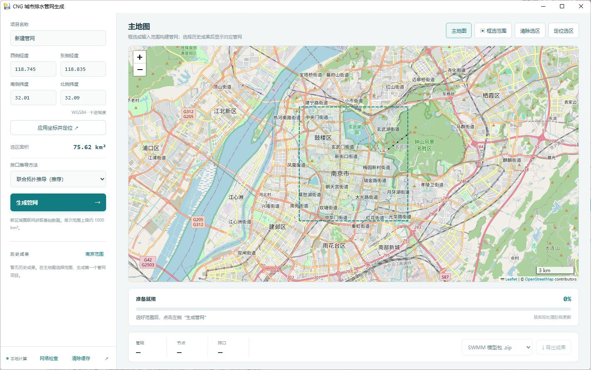
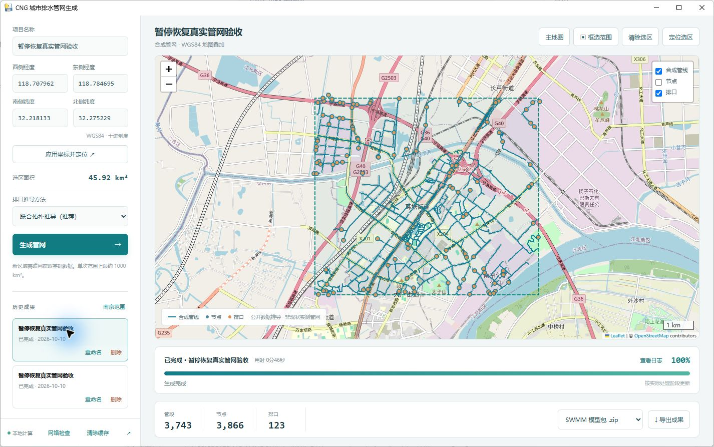

# CNG 城市排水管网生成

基于 **[SWMManywhere 0.2.2](https://github.com/ImperialCollegeLondon/SWMManywhere)** 的中文桌面应用。在地图上框选区域或输入经纬度，联网获取公开地理数据，在本机生成、查看和导出合成排水管网。

**代码来源：SWMManywhere，原作者及贡献者来自其上游项目。本仓库是在该开源项目基础上的桌面化开发，不是 SWMManywhere 官方发行版。** 上游源代码副本位于 [`vendor/swmmanywhere-src`](vendor/swmmanywhere-src)，保留 [BSD-3-Clause 原始许可证](vendor/LICENSE-SWMManywhere)。

## 软件界面

主地图不自动显示历史管网，可以直接选择下一次生成范围：



选择已完成项目后，在原地图上叠加管线和排口，下面显示进度、统计及导出功能：



以上截图来自 Windows 实际运行界面（2026-10-11），展示南京测试范围的合成管网。底图 © [OpenStreetMap contributors](https://www.openstreetmap.org/copyright)。

## 功能

- 大面积交互地图，矩形框选和 WGS84 边界坐标双向同步，单次面积上限约 **1000 km²**。
- 联网获取高程、建筑、道路和河流；OSM 分块请求、完整结果缓存、有限重试与备用服务恢复。
- 地图下方显示阶段百分比、中文状态和已用时间，下载或计算等待时不虚增百分比。
- 暂停、恢复、停止并取消生成；暂停在安全步骤边界生效，**仅在本次软件会话中有效**。
- 历史项目查看、重命名和删除；清理基础数据缓存或地图缓存，删除项目时询问是否同时清除缓存。
- 管线、节点、排口图层及属性查看；导出 SWMM 模型包、`.inp`、PNG、GeoParquet、GeoJSON。
- 本机服务只监听 `127.0.0.1`，带会话校验；计算在独立工作进程中执行。

## 使用与平台状态

| 平台 | 状态 | 入口 |
| --- | --- | --- |
| Windows 10/11 x64 | 已构建便携包，已有真实生成与回归测试 | 解压 `SWMManywhereStudio-Windows-x64.zip`，双击 `SWMManywhereStudio.exe` |
| Apple 芯片 Mac | 已准备适配源码和构建脚本，**尚未完成 Mac 编译与实测** | 将源码复制到 Mac，按 [Mac 构建说明](README_MAC.md) 继续 |

Windows 便携包包含 Python、GIS 依赖和桌面运行环境，无需另外安装 Python。必须保留整个软件文件夹，不能只复制 EXE。源码 ZIP 不包含运行环境，不能当作便携程序直接运行。

1. 启动后在主地图框选范围，或填入西、南、东、北边界坐标并应用。
2. 输入项目名称和排口方法，点击“生成管网”。
3. 查看下方状态；完成后查看图层和属性，导出模型包。

详细操作、网络排查、缓存规则和数据迁移见 [使用说明](README_APP.md)。

## 数据与适用范围

成果是由公开数据推导的**合成排水管网，不是实测地下管线**。使用前需结合实际资料检查和校准。当前界面不包括手工管线编辑、完全离线数据导入或水力模拟。

新区域生成需要访问 OSM、建筑和高程数据服务。公共服务可能限流或暂时不可用；软件遵守服务冷却时间，不保证所有网络环境和所有范围都能成功生成。1000 km² 是本应用的输入上限，不是上游官方承诺的最大规模，也不是耗时保证。

每个项目独立保存成果；完整下载缓存可跨任务复用。清除缓存不删除已生成模型。删除项目并勾选清除缓存会清理**全局共享基础数据缓存**，详见使用说明。源代码仓库和发布包不携带用户历史成果或私人配置。

## 开发与测试

使用 Python 3.12。Windows 安装 `requirements-lock.txt` 中的依赖后，可运行：

```powershell
python desktop.py
python -m pytest tests -q
node --test tests/frontend-state.test.cjs
```

Mac 构建执行 `bash build-macos.command`，详见 [README_MAC.md](README_MAC.md)。Windows 重建还需准备原生工具和固定 WebView2，参见 [构建说明](BUILDING.md)。

| 目录 / 文件 | 用途 |
| --- | --- |
| `desktop.py`、`desktop_platform.py` | 桌面窗口、原生系统适配 |
| `app.py`、`execution_control.py`、`process_control.py` | 任务服务、暂停恢复、进程控制 |
| `generator.py`、`artifacts.py` | 生成入口与成果导出 |
| `map_service.py`、`cache_management.py` | 底图访问、共享缓存管理 |
| `web/` | 本地 Leaflet 界面 |
| `vendor/swmmanywhere-src/` | SWMManywhere 核心及本地修改 |
| `tests/`、`packaging/` | 回归测试、构建与验收工具 |

真实大范围测试记录：[约 600 km² 无缓存测试](TEST_COLD_600_20261009.md)、[约 1000 km² 测试](TEST_1000_20261008.md)。1000 km² 测试复用了高程和建筑缓存，不能表述为全量无缓存测试；记录中也说明了未运行水力模拟及模型警告。

## 来源与许可证

- 核心算法与初始代码：[ImperialCollegeLondon/SWMManywhere](https://github.com/ImperialCollegeLondon/SWMManywhere)，版本 0.2.2，BSD-3-Clause；原始版权 `Copyright (c) 2022, barneydobson`。
- 本项目的主要改动：中文桌面界面、结构化进度、任务与历史管理、网络下载恢复、缓存校验、暂停恢复、模型导出及兼容性修复。改动不意味着上游作者认可或背书本应用。
- 本仓库应用代码使用 [BSD-3-Clause](LICENSE)。其他组件保留各自许可证，见 [第三方说明](THIRD-PARTY-NOTICES.md) 与 [`licenses/`](licenses)。
- Leaflet、Leaflet.draw、pywebview、WhiteboxTools、SWMM Toolkit 等第三方组件及地理数据均应遵守其各自许可。Windows 固定 WebView2 是独立运行时，不适用本项目的 BSD 许可证。

感谢 SWMManywhere 原作者和所有上游贡献者。
